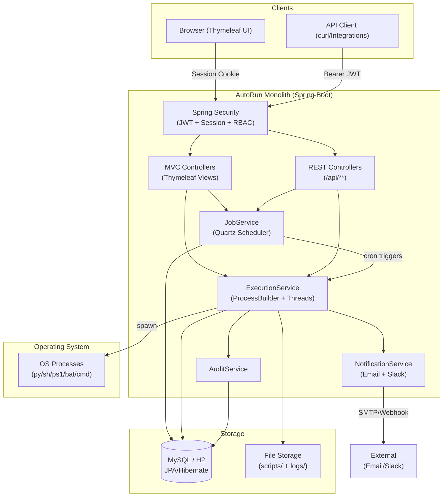
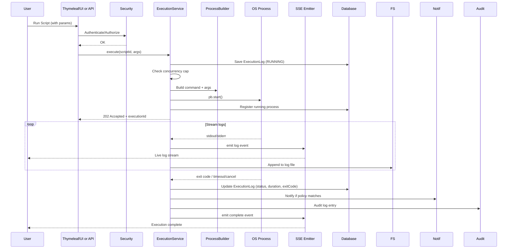
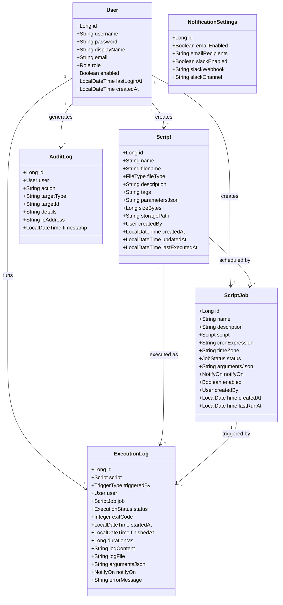

<div align="center">

# AutoRun — Automation Script Runner

**A secure, centralized platform to upload, schedule, and execute IT automation scripts — with live logs, audit trails, and alerts.**


[](https://hub.docker.com/r/ogc16/autorun)
[](https://github.com/ogc16/autorun/packages)


Replaces manual, error-prone ops work (backups, patching, user provisioning) with a single
dashboard where every action is **auditable**, every run is **logged in real time**, and every
failure can **page you** via email or Slack.

</div>

---

## Features

| | |
|---|---|
| **Script Library** | Upload `.sh`, `.py`, `.ps1`, `.bat` / `.cmd` files with descriptions, tags, and **declared CLI parameters** that render as input fields on the Run form. |
| **On-demand execution** | Click **Run** and watch **stdout/stderr stream live** (Server-Sent Events). Get an exit code, download the full log. A hard timeout kills hung scripts. |
| **Quartz scheduler** | Cron-based recurring jobs (`0 0 2 ? * SUN`) with pause / resume / run-now and a live next-fire-time preview. |
| **RBAC** | `ADMIN` (full control) vs `TECH` (run approved scripts, schedule jobs, view own logs). Enforced on both UI and REST API via Spring Security method security. |
| **JWT auth** | Token-based REST API (`/api/**`) alongside session-based form login for the Thymeleaf UI. |
| **Audit trail** | Every run, upload, delete, schedule, and cancel is logged with actor, target, IP, and timestamp — exportable as CSV. |
| **Alerts** | Email and Slack webhook notifications on script/job failure, with a per-run `FAILURE` / `ALWAYS` / `NEVER` policy. |
| **Docker-ready** | Multi-stage `Dockerfile` with tini, non-root user, JVM container tuning. `docker-compose.yml` for local dev. |
| **Kubernetes / GKE** | Production-ready K8s manifests: Deployment, HPA, PDB, Ingress with managed TLS, Cloud SQL Proxy sidecar. One-command deploy script. |
| **10 bundled scripts** | Cross-platform automation out of the box: system info, disk usage, SSL checks, log collection, service monitoring, process restart, and more. |

## Tech Stack

| Layer | Technology |
|---|---|
| Backend | Java 17, Spring Boot 3.3, Spring Security 6 |
| Script execution | `java.lang.ProcessBuilder` → Python / Bash / PowerShell / CMD |
| Scheduling | Quartz (cron triggers) |
| Persistence | Spring Data JPA / Hibernate — H2 (dev) or MySQL 8 (prod profile) |
| Frontend | Thymeleaf + Bootstrap 5, SSE live logs, no build step |
| Auth | JWT (jjwt) for REST, Spring Security sessions for the UI |
| Notifications | Spring JavaMail + Slack Incoming Webhooks |
| Build / Deploy | Maven, Docker, GitHub Actions CI |
| Orchestration | Kubernetes (GKE), HPA, PDB, Managed Certificates, Cloud SQL Proxy |

## Quick Start

Prerequisites: **Java 17+** and **Maven** (or use the bundled `./mvnw` wrapper).

```bash
# build
mvn -DskipTests package

# run (H2 file database, nothing else required)
java -jar target/autorun-1.0.0.jar
```

Open **http://localhost:8080** and sign in:

| Role | Username | Password | Capabilities |
|---|---|---|---|
| Admin | `admin` | `admin123` | everything |
| Tech | `tech` | `tech123` | run scripts, schedule jobs, own logs only |

> **Note:** Change the seeded passwords and the `AUTORUN_JWT_SECRET` before any real deployment.

### Docker

```bash
docker compose up --build     # H2 in-memory, single container
# open http://localhost:8080
```

### Kubernetes / GKE

```bash
# One-command deploy to GKE (requires gcloud CLI + Docker)
./deploy-gke.sh --project my-gcp-project --region us-central1 --domain autorun.mycompany.com
```

Or apply manifests manually:

```bash
kubectl apply -f k8s/namespace.yml
kubectl apply -f k8s/           # all manifests
kubectl -n autorun get ingress   # get external IP
```

See [`k8s/`](k8s/) for all manifests and [`deploy-gke.sh`](deploy-gke.sh) for the full deployment script.

## Demo in 60 Seconds

1. Log in as **`admin`** → **Scripts** → open **`system_info`** → **Run Script**.
2. Watch the log stream live, see **SUCCESS / exit 0**.
3. **Scheduler** → **New Job** → script `collect_logs`, cron `0 */30 * * * ?`, click **Preview**, save.
4. Open **Audit** — every action, with actor + IP.
5. Try the REST API:

```bash
TOKEN=$(curl -s -X POST http://localhost:8080/api/auth/login \
  -H "Content-Type: application/json" \
  -d '{"username":"admin","password":"admin123"}' | jq -r .accessToken)

curl -s -X POST http://localhost:8080/api/scripts/1/execute \
  -H "Authorization: Bearer $TOKEN" \
  -H "Content-Type: application/json" \
  -d '{"arguments":{"days":"3"}}'
```

### Bundled Scripts

| Script | Type | Platform | Description |
|---|---|---|---|
| `system_info` | `.cmd` | Cross-platform | CPU, memory, disk, network info |
| `collect_logs` | `.py` | Cross-platform | Collect and summarize log files |
| `backup` | `.sh` | Linux | Tar backup of a directory |
| `patch_apt` | `.sh` | Linux | APT update & upgrade |
| `add_user` | `.sh` | Linux | Provision a new Linux user |
| `disk_usage` | `.py` | Cross-platform | Disk usage report by path |
| `check_services` | `.sh` | Linux | Check systemd service status |
| `cleanup_temp` | `.sh` | Linux | Remove old temporary files |
| `ssl_check` | `.py` | Cross-platform | Check SSL certificate expiry |
| `restart_process` | `.py` | Cross-platform | Restart a process by name |

## Documentation

| Document | Contents |
|---|---|
| [**REST API Reference**](docs/API.md) | Every endpoint, schema, error code, curl workflows |
| [**Architecture**](docs/ARCHITECTURE.md) | Design decisions, data model, execution engine, security model |
| [**User Guide**](docs/USER_GUIDE.md) | Roles, step-by-step walkthroughs, sample scripts |
| [**Deployment**](docs/DEPLOYMENT.md) | Docker, Kubernetes/GKE, environment variables, production hardening |

## UML Diagrams

### System Architecture (Component Diagram)



### Execution Flow (Sequence Diagram)



### Data Model (Class Diagram)



## Project Layout

```
src/main/java/com/autorun/
├── config/        DataInitializer (seed users/scripts), GlobalExceptionHandler
├── controller/    REST API (/api/**) + Thymeleaf view controllers
├── model/         User, Script, ScriptJob, ExecutionLog, AuditLog, enums
├── repository/    Spring Data JPA repositories
├── security/      JwtUtil, JwtAuthFilter, SecurityConfig, UserDetailsService
├── service/       ScriptService, ExecutionService, JobService, NotificationService, AuditService
└── util/          JSON helpers, argument resolution
src/main/resources/
├── scripts/       10 sample scripts bundled at startup
├── templates/     Thymeleaf pages (dashboard, scripts, jobs, executions, audit)
└── application.yml
k8s/               Kubernetes manifests for GKE deployment
├── namespace.yml, serviceaccount.yml
├── configmap.yml, secret.yml
├── deployment.yml, deployment-with-cloudsql.yml
├── service.yml, ingress.yml, managed-cert.yml
├── hpa.yml, pdb.yml, pvc.yml
deploy-gke.sh      One-command GKE deployment script
Dockerfile         Multi-stage build (Maven → JRE + tini)
docker-compose.yml Local dev (H2)
.github/           CI/CD workflows (ci.yml, release.yml)
```

## Security Notes

- Scripts run with the privileges of the app process — deploy AutoRun **inside the Docker container
  as a non-root user** on an isolated host in production.
- Kubernetes manifests include **security context** (non-root, read-only root filesystem, seccomp profile).
- Hard **10-minute timeout** and a **max-concurrent-executions** cap prevent runaway/hung processes.
- Uploads are restricted to a whitelist of extensions and a **5 MB** size limit.
- Passwords are **BCrypt-hashed**; the REST API is protected by short-lived **JWT** access tokens.
- In production, swap H2 for **MySQL 8** (Cloud SQL on GKE) with `ddl-auto: validate`.

## Roadmap

- [x] Docker-ready deployment (multi-stage build, compose)
- [x] Kubernetes / GKE manifests (Deployment, HPA, PDB, Ingress, Cloud SQL Proxy)
- [x] CI/CD pipeline (GitHub Actions)
- [x] 10 bundled automation scripts
- [ ] Lightweight Java **server agent** for remote / distributed execution
- [ ] Dashboard analytics (success-rate charts), Splunk / Jira integration
- [ ] Git-backed script version control
- [ ] Immutable audit logs with external sink (Syslog / ELK)

## License

[MIT](LICENSE)

---

*Built as a portfolio project: Automation · Systems Support · Cybersecurity.*
